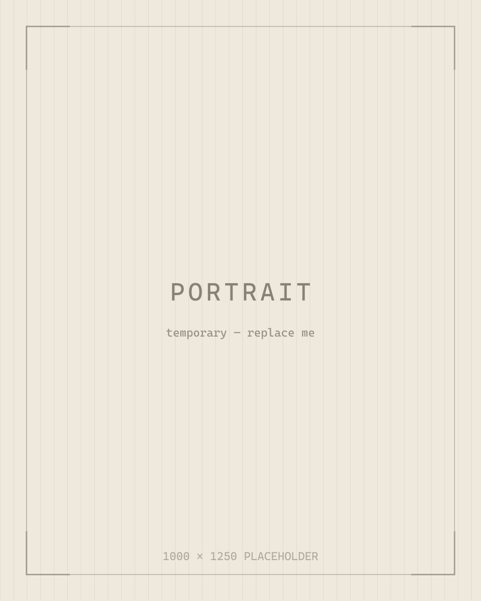

<!--
  TODO — replace everything in this file. It is the only page written as prose
  rather than a dated piece, so nothing on it needs a date or a title change.

  Keep the structure if you like it: a short opening claim, what you work on,
  then how to reach you. Delete the headings that do not apply.
-->

TODO — one paragraph, first person, that says who you are and what you spend
your working hours on. Avoid the résumé voice here; this is the page people read
when they want to know whether to email you.

## What I work on

TODO — two or three sentences on the area you would happily talk about for an
hour. Name the domain, not the job title.

## Elsewhere

- GitHub — [github.com/Gu-sheng27](https://github.com/Gu-sheng27)
- TODO — add X, LinkedIn, or an email address. Delete this line if you would
  rather not be contacted.

## Colophon

Set in [Newsreader](https://github.com/productiontype/Newsreader) and
[JetBrains Mono](https://www.jetbrains.com/lp/mono/), both self-hosted. Built
with [Astro](https://astro.build). No trackers, no cookies.